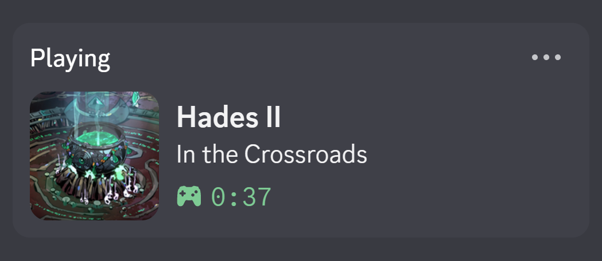
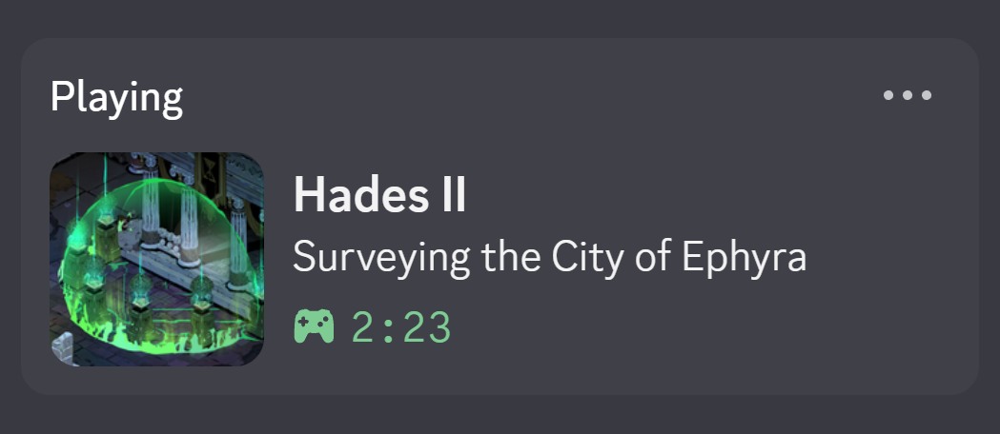
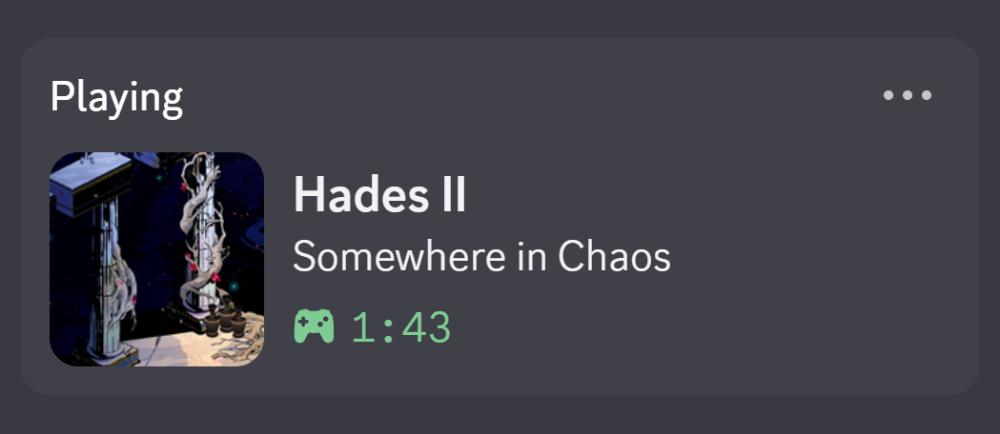
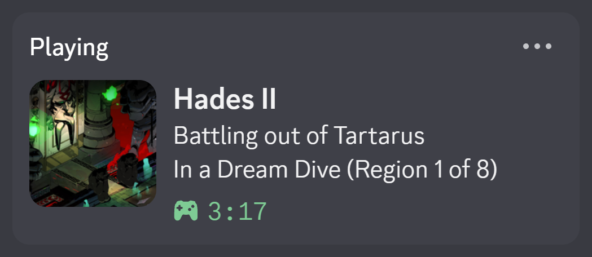

# Discord Rich Presence

Hades II mods that shows your current Hades II location or encounter as a Discord Rich Presence status.
This includes custom status messages for boss and story encounters, as well as status details when in a Chaos Trial or Dream Dive.
The timer in the status message will also show others how much time you have spent in your current run.

The mod is also compatible with [Zagreus' Journey](https://thunderstore.io/c/hades-ii/p/NikkelM/Zagreus_Journey/) and will show status messages for the new locations and encounters it adds.
If you are using [Dream Dive Tweaks](https://thunderstore.io/c/hades-ii/p/zerp/DreamDiveTweaks/) for longer Dream Dives, the Rich Presence status will also indicate the new maximum number of regions in the run, or if you are in endless mode.

  
  

  
  

## Contribution

Does your mod add new encounter types or locations that you would like to show as a custom Rich Presence status?
Create a PR that adds the new status, and reach out to @NikkelM on the [community Discord](https://discordapp.com/invite/KuMbyrN) to have the image/screenshot added to the Discord App.
